# HAVEN - Student Hostel & Accommodation Network

> **Course:** S3 B.Tech Computer Science & Engineering — CST 205 Object-Oriented Programming (Java) Lab Project  
> **Institution:** SCT College of Engineering (SCTCE), Thiruvananthapuram | APJ Abdul Kalam Technological University (KTU)  
> **Team Members:** Arjun AV, Ansia Sheas, Aida Elza George, Anjana Krishnan

---

## 1. Project Overview & Motivation

Finding safe, affordable, and verified student accommodation around major engineering colleges in Trivandrum (**SCTCE Pappanamcode, CET Kulathoor, GEC Barton Hill, MBCET, and LBS**) has always been a painful experience. Students typically rely on torn paper flyers on bus stops, word-of-mouth recommendations, or local brokers who charge high commissions. Even after finding a stay, students often discover hidden electricity bills, unexpected mess rules, or that all rooms are already full.

We built **HAVEN** to solve this exact problem for our college student community.

HAVEN is a Java Swing desktop platform that connects **Students**, **Property Owners / Wardens**, and **Platform Administrators**:
* **Students** can discover verified hostels/PGs with advanced multi-criteria filtering, explore properties on an interactive **OpenStreetMap** canvas, view disk-backed photo galleries, compare stays side-by-side, send live booking enquiries, and chat directly with wardens.
* **Property Owners** can manage room vacancies, upload photos, process incoming student enquiries through a structured approval pipeline, and track occupancy analytics.
* **Administrators** can moderate listings, manage accounts, audit reviews, and roll back administrative operations with full **Undo / Redo** support.

---

## 2. Engineering Journey: Challenges We Faced & How We Solved Them

Building HAVEN pushed us well beyond standard textbook examples. Over several weeks of development, testing, and debugging, we tackled three major technical hurdles:

### Challenge 1: The College Lab WiFi & MongoDB Problem (Dual Persistence)
* **The Problem:** In our local development setups, we used MongoDB (`localhost:27017`). However, when testing on college lab computers, MongoDB was not installed and the campus firewall blocked external database ports.
* **Our Solution:** Instead of giving up on database persistence, we refactored our data layer using the **Abstract Factory** and **Repository** patterns. We implemented two parallel repository engines:
  1. `MongoRepositoryFactory`: Uses the official MongoDB Java driver for production/local server mode.
  2. `InMemoryRepositoryFactory` + `FilePersistenceManager`: An offline engine backed by a thread-safe JSON file (`data/haven_store.json`).
* If MongoDB is unreachable on startup, HAVEN displays an offline notice and falls back to offline storage without crashing.

### Challenge 2: Swing Event Dispatch Thread (EDT) Freezing
* **The Problem:** Early versions froze whenever we queried large datasets or loaded property photos from disk.
* **Our Solution:** We decoupled operations using `SwingWorker` for background loading and built a lightweight, thread-safe pub/sub event bus ([`HavenEventBus`](file:///c:/Users/minod/OneDrive/Desktop/s3/oop/project/src/haven/pattern/event/HavenEventBus.java)) to dispatch domain events (`AccommodationEvent`, `EnquiryEvent`, `ChatEvent`) safely back onto the EDT using `SwingUtilities.invokeLater`.

### Challenge 3: Eliminating Spaghetti Code with GoF Design Patterns
* **The Problem:** Early on, our booking status logic was filled with nested `if-else` checks on strings, constructors had 15+ parameters, and admin actions had no safety net.
* **Our Solution:** We applied the design patterns taught in our S3 syllabus:
  * **State Pattern** for enquiry lifecycles (`PendingState` → `ContactedState` → `ConfirmedState`), preventing illegal status transitions.
  * **Builder Pattern** for constructing complex `Hostel` and `PG` records.
  * **Command Pattern** with an undo/redo stack in the Admin Dashboard.
  * **Adapter Pattern** for embedding OpenStreetMap tile rendering via `JXMapViewer2`.

---

## 3. Table of Contents
1. [Core Features by Role](#core-features-by-role)
2. [Object-Oriented Programming (OOP) Architecture](#object-oriented-programming-oop-architecture)
3. [Design Patterns Implemented (14 Total)](#design-patterns-implemented-14-total)
4. [Mermaid UML Class Diagram](#mermaid-uml-class-diagram)
5. [Dual-Mode Data Architecture & Offline File Persistence](#dual-mode-data-architecture--offline-file-persistence)
6. [Project Structure](#project-structure)
7. [Getting Started & Setup](#getting-started--setup)
8. [Automated Verification & Testing (30 Suites)](#automated-verification--testing-30-suites)
9. [Pre-Configured Demo Accounts](#pre-configured-demo-accounts)

---

## Core Features by Role

### For Students (`STUDENT`)
- **Advanced Multi-Criteria Search & Iterator Filtering**: Filter stays by live keyword search, college proximity, gender eligibility, accommodation type (*Hostel vs PG*), min/max monthly rent, max distance (`km`), minimum star rating (`3★+`, `4★+`), vacancy availability, and multi-select amenities (`WiFi`, `Food / Mess`, `Attached Washroom`, `CCTV Security`, `Power Backup`), powered by [`FilteredAccommodationIterator`](file:///c:/Users/minod/OneDrive/Desktop/s3/oop/project/src/haven/pattern/iterator/FilteredAccommodationIterator.java).
- **Interactive Embedded Map View (`JXMapViewer2` + OpenStreetMap)**: Explore verified properties spatially on an interactive OpenStreetMap canvas ([`MapPanel`](file:///c:/Users/minod/OneDrive/Desktop/s3/oop/project/src/haven/view/MapPanel.java)) with custom price/vacancy pin overlays, click-to-inspect detail drawer, college quick-jump buttons, and external browser fallback.
- **Property Photo Gallery & Carousel**: View disk-backed property thumbnails directly on [`ListingCardPanel`](file:///c:/Users/minod/OneDrive/Desktop/s3/oop/project/src/haven/view/ListingCardPanel.java) and open the full [`ImageGalleryDialog`](file:///c:/Users/minod/OneDrive/Desktop/s3/oop/project/src/haven/view/ImageGalleryDialog.java) carousel (`< Prev` / `Next >`) with captions.
- **Real-Time In-App Chat with Wardens**: Start pre-booking or enquiry-linked message threads with property owners via [`ChatDialog`](file:///c:/Users/minod/OneDrive/Desktop/s3/oop/project/src/haven/view/ChatDialog.java), backed by reactive [`ChatEvent`](file:///c:/Users/minod/OneDrive/Desktop/s3/oop/project/src/haven/pattern/event/ChatEvent.java) delivery.
- **Persistent Notification Inbox**: Track booking confirmations, status changes, and incoming chat replies in [`NotificationInboxDialog`](file:///c:/Users/minod/OneDrive/Desktop/s3/oop/project/src/haven/view/NotificationInboxDialog.java) with an unread counter badge in the top navigation bar.
- **Side-by-Side Comparison Tool**: Select up to 3 stays and open [`CompareDialog`](file:///c:/Users/minod/OneDrive/Desktop/s3/oop/project/src/haven/view/CompareDialog.java) to compare polymorphic monthly costs, curfew, distance, ratings, and amenities.
- **Enhanced Booking History & State Lifecycle**: Filter and sort enquiries by status (`PENDING`, `CONTACTED`, `CONFIRMED`, `DECLINED`, `CANCELLED`) and date in [`StudentEnquiriesPanel`](file:///c:/Users/minod/OneDrive/Desktop/s3/oop/project/src/haven/view/StudentEnquiriesPanel.java), withdraw active enquiries (automatically restoring room vacancy), or download formatted `.txt` booking slips via [`BookingReceiptReport`](file:///c:/Users/minod/OneDrive/Desktop/s3/oop/project/src/haven/pattern/report/BookingReceiptReport.java).

### For Property Owners / Wardens (`OWNER`)
- **Property Listing CRUD & Photo Management**: Create, update, and remove Hostels and PGs via fluent builders ([`HostelBuilder`](file:///c:/Users/minod/OneDrive/Desktop/s3/oop/project/src/haven/pattern/builder/HostelBuilder.java), [`PGBuilder`](file:///c:/Users/minod/OneDrive/Desktop/s3/oop/project/src/haven/pattern/builder/PGBuilder.java)), and upload/delete property photos (`JPG`/`PNG`) directly to `images/<accommodationId>/`.
- **Enquiry State Pipeline & Student Chat**: Transition incoming enquiries through validated state transitions (`PendingState` $\rightarrow$ `ContactedState` $\rightarrow$ `ConfirmedState` / `DeclinedState`), message applicants directly from [`OwnerDashboardPanel`](file:///c:/Users/minod/OneDrive/Desktop/s3/oop/project/src/haven/view/OwnerDashboardPanel.java), and export applicant rosters via [`ApplicantRosterReport`](file:///c:/Users/minod/OneDrive/Desktop/s3/oop/project/src/haven/pattern/report/ApplicantRosterReport.java).
- **Custom Java 2D Analytics & Revenue Projections**: Real-time KPI summary cards, antialiased enquiry status bar chart, and circular occupancy gauge rendered in [`AnalyticsPanel`](file:///c:/Users/minod/OneDrive/Desktop/s3/oop/project/src/haven/view/AnalyticsPanel.java).

### For Platform Administrators (`ADMIN`)
- **Admin Governance Portal ([`AdminDashboardPanel`](file:///c:/Users/minod/OneDrive/Desktop/s3/oop/project/src/haven/view/AdminDashboardPanel.java))**:
  - **User Management**: Activate/deactivate user accounts (blocking deactivated users at login) or delete non-admin accounts.
  - **Property Moderation & Featured Promotions**: Approve, flag, or reject property listings (`APPROVED`, `FLAGGED`, `REJECTED`), toggle featured promotional status (rendered via [`FeaturedAccommodationDecorator`](file:///c:/Users/minod/OneDrive/Desktop/s3/oop/project/src/haven/pattern/decorator/FeaturedAccommodationDecorator.java)), and manage photos on any property.
  - **Review Moderation**: Inspect all student reviews across stays, flag inappropriate content, or remove reviews.
  - **Reversible Undo / Redo Stack**: Every administrative action is encapsulated as an [`AdminCommand`](file:///c:/Users/minod/OneDrive/Desktop/s3/oop/project/src/haven/pattern/command/AdminCommand.java) managed by [`CommandHistory`](file:///c:/Users/minod/OneDrive/Desktop/s3/oop/project/src/haven/pattern/command/CommandHistory.java), providing instant one-click **Undo** and **Redo** in the Admin header bar.
  - **System-Wide Analytics & Seed Data Management**: Export comprehensive platform reports ([`SystemAnalyticsReport`](file:///c:/Users/minod/OneDrive/Desktop/s3/oop/project/src/haven/pattern/report/SystemAnalyticsReport.java)), export JSON snapshots, or reset the platform to default verified SCTCE seed data.

---

## Object-Oriented Programming (OOP) Architecture

### 1. Abstraction
- **Generic Base Repository**: [`Repository<T, ID>`](file:///c:/Users/minod/OneDrive/Desktop/s3/oop/project/src/haven/repository/Repository.java) defines type-safe CRUD operations (`save`, `findById`, `findAll`, `deleteById`, `count`, `existsById`) across all 7 domain repositories.
- **Abstract Classes**:
  - [`Accommodation`](file:///c:/Users/minod/OneDrive/Desktop/s3/oop/project/src/haven/model/Accommodation.java): Defines common state (`id`, `name`, `baseRent`, `distanceKm`, `amenities`, `imagePaths`, `moderationStatus`, `featured`) and the abstract polymorphic contract `calculateTotalMonthlyCost(int sharingRooms)`.
  - [`User`](file:///c:/Users/minod/OneDrive/Desktop/s3/oop/project/src/haven/model/User.java): Base identity, role, account activation (`active`), and wishlist state.
  - [`ReportGenerator`](file:///c:/Users/minod/OneDrive/Desktop/s3/oop/project/src/haven/pattern/report/ReportGenerator.java): Defines the invariant `final generate()` template method for all platform reports.
- **Behavioral Interfaces**: [`EnquiryState`](file:///c:/Users/minod/OneDrive/Desktop/s3/oop/project/src/haven/pattern/state/EnquiryState.java), [`AdminCommand`](file:///c:/Users/minod/OneDrive/Desktop/s3/oop/project/src/haven/pattern/command/AdminCommand.java), [`PanelMediator`](file:///c:/Users/minod/OneDrive/Desktop/s3/oop/project/src/haven/pattern/mediator/PanelMediator.java), [`NavigationService`](file:///c:/Users/minod/OneDrive/Desktop/s3/oop/project/src/haven/pattern/NavigationService.java), and [`RepositoryFactory`](file:///c:/Users/minod/OneDrive/Desktop/s3/oop/project/src/haven/repository/RepositoryFactory.java).

### 2. Encapsulation & Invariant Enforcement
- All domain fields are `private` with domain-invariant validation (`baseRent > 0`, `vacancies >= 0`, `distanceKm >= 0`, `rating in [1..5]`).
- Passwords are encrypted using SHA-256 hashing in [`SecurityUtils`](file:///c:/Users/minod/OneDrive/Desktop/s3/oop/project/src/haven/pattern/SecurityUtils.java) and stripped from active session objects.
- Collections (`amenities`, `wishlist`, `imagePaths`, `propertyIds`) are protected via defensive copying.

### 3. Inheritance
- **Accommodation Hierarchy**: [`Hostel`](file:///c:/Users/minod/OneDrive/Desktop/s3/oop/project/src/haven/model/Hostel.java), [`PG`](file:///c:/Users/minod/OneDrive/Desktop/s3/oop/project/src/haven/model/PG.java), and [`AccommodationDecorator`](file:///c:/Users/minod/OneDrive/Desktop/s3/oop/project/src/haven/pattern/decorator/AccommodationDecorator.java) $\rightarrow$ [`FeaturedAccommodationDecorator`](file:///c:/Users/minod/OneDrive/Desktop/s3/oop/project/src/haven/pattern/decorator/FeaturedAccommodationDecorator.java) all extend [`Accommodation`](file:///c:/Users/minod/OneDrive/Desktop/s3/oop/project/src/haven/model/Accommodation.java).
- **User Role Hierarchy**: [`Student`](file:///c:/Users/minod/OneDrive/Desktop/s3/oop/project/src/haven/model/Student.java), [`Owner`](file:///c:/Users/minod/OneDrive/Desktop/s3/oop/project/src/haven/model/Owner.java), and [`Admin`](file:///c:/Users/minod/OneDrive/Desktop/s3/oop/project/src/haven/model/Admin.java) all extend [`User`](file:///c:/Users/minod/OneDrive/Desktop/s3/oop/project/src/haven/model/User.java).

### 4. Runtime Polymorphism (Dynamic Method Dispatch)
- `calculateTotalMonthlyCost(int sharingRooms)` is dispatched dynamically at runtime:
  - **Hostel**:
    $$\text{Total Cost} = (\text{Base Rent} \times \text{Sharing Factor}) + \text{Fixed Mess Fee}$$
  - **PG**:
    $$\text{Total Cost} = (\text{Base Rent} - \text{Sharing Discount}) + \text{Utility Charges} + \text{Food Fee}$$
  - **FeaturedAccommodationDecorator**:
    $$\text{Total Cost} = \operatorname{round}\!\left(\text{Wrapped Cost} \times \left(1 - \frac{\text{Discount \%}}{100}\right)\right)$$

---

## Design Patterns Implemented (14 Total)

| # | Design Pattern | Category | Implementation Classes | Architectural Purpose |
| :- | :--- | :--- | :--- | :--- |
| 1 | **Abstract Factory** | Creational | [`RepositoryFactory`](file:///c:/Users/minod/OneDrive/Desktop/s3/oop/project/src/haven/repository/RepositoryFactory.java), [`MongoRepositoryFactory`](file:///c:/Users/minod/OneDrive/Desktop/s3/oop/project/src/haven/repository/mongo/MongoRepositoryFactory.java), [`InMemoryRepositoryFactory`](file:///c:/Users/minod/OneDrive/Desktop/s3/oop/project/src/haven/repository/inmemory/InMemoryRepositoryFactory.java) | Creates families of 7 domain repositories dynamically for MongoDB or Offline JSON storage. |
| 2 | **Builder** | Creational | [`AccommodationBuilder`](file:///c:/Users/minod/OneDrive/Desktop/s3/oop/project/src/haven/pattern/builder/AccommodationBuilder.java), [`HostelBuilder`](file:///c:/Users/minod/OneDrive/Desktop/s3/oop/project/src/haven/pattern/builder/HostelBuilder.java), [`PGBuilder`](file:///c:/Users/minod/OneDrive/Desktop/s3/oop/project/src/haven/pattern/builder/PGBuilder.java) | Fluent, self-validating construction of complex `Hostel` and `PG` aggregates without telescoping constructors. |
| 3 | **Singleton** | Creational | [`MongoDBConnection`](file:///c:/Users/minod/OneDrive/Desktop/s3/oop/project/src/haven/pattern/MongoDBConnection.java), [`InMemoryStore`](file:///c:/Users/minod/OneDrive/Desktop/s3/oop/project/src/haven/db/InMemoryStore.java), [`HavenEventBus`](file:///c:/Users/minod/OneDrive/Desktop/s3/oop/project/src/haven/pattern/event/HavenEventBus.java) | Guarantees a single shared instance for DB connection pools, in-memory cache, and event dispatching. |
| 4 | **Adapter** | Structural | [`GoogleMapsAdapter`](file:///c:/Users/minod/OneDrive/Desktop/s3/oop/project/src/haven/pattern/GoogleMapsAdapter.java), [`OpenStreetMapAdapter`](file:///c:/Users/minod/OneDrive/Desktop/s3/oop/project/src/haven/pattern/OpenStreetMapAdapter.java) | Adapts both external Google Maps browser URLs and embedded `JXMapViewer2` OpenStreetMap tile rendering to [`NavigationService`](file:///c:/Users/minod/OneDrive/Desktop/s3/oop/project/src/haven/pattern/NavigationService.java). |
| 5 | **Decorator** | Structural | [`AccommodationDecorator`](file:///c:/Users/minod/OneDrive/Desktop/s3/oop/project/src/haven/pattern/decorator/AccommodationDecorator.java), [`FeaturedAccommodationDecorator`](file:///c:/Users/minod/OneDrive/Desktop/s3/oop/project/src/haven/pattern/decorator/FeaturedAccommodationDecorator.java) | Dynamically wraps any `Accommodation` with promotional ribbons (`★ FEATURED STAY`) and optional promotional discounts. |
| 6 | **Facade** | Structural | [`HostelDAO`](file:///c:/Users/minod/OneDrive/Desktop/s3/oop/project/src/haven/db/HostelDAO.java), [`UserDAO`](file:///c:/Users/minod/OneDrive/Desktop/s3/oop/project/src/haven/db/UserDAO.java), [`EnquiryDAO`](file:///c:/Users/minod/OneDrive/Desktop/s3/oop/project/src/haven/db/EnquiryDAO.java), [`ReviewDAO`](file:///c:/Users/minod/OneDrive/Desktop/s3/oop/project/src/haven/db/ReviewDAO.java) | Provides simplified, backward-compatible data access facades delegating to the active `RepositoryFactory`. |
| 7 | **Repository (Generics)** | Enterprise | [`Repository<T, ID>`](file:///c:/Users/minod/OneDrive/Desktop/s3/oop/project/src/haven/repository/Repository.java) & 7 domain repository contracts | Decouples domain and presentation layers from persistence details using Java Generics. |
| 8 | **Observer** | Behavioral | [`HavenEventBus`](file:///c:/Users/minod/OneDrive/Desktop/s3/oop/project/src/haven/pattern/event/HavenEventBus.java), [`AccommodationEvent`](file:///c:/Users/minod/OneDrive/Desktop/s3/oop/project/src/haven/pattern/event/AccommodationEvent.java), [`EnquiryEvent`](file:///c:/Users/minod/OneDrive/Desktop/s3/oop/project/src/haven/pattern/event/EnquiryEvent.java), [`ReviewEvent`](file:///c:/Users/minod/OneDrive/Desktop/s3/oop/project/src/haven/pattern/event/ReviewEvent.java), [`ChatEvent`](file:///c:/Users/minod/OneDrive/Desktop/s3/oop/project/src/haven/pattern/event/ChatEvent.java), [`NotificationEvent`](file:///c:/Users/minod/OneDrive/Desktop/s3/oop/project/src/haven/pattern/event/NotificationEvent.java) | Thread-safe pub/sub bus delivering real-time domain, chat, and notification updates across UI panels. |
| 9 | **State** | Behavioral | [`EnquiryState`](file:///c:/Users/minod/OneDrive/Desktop/s3/oop/project/src/haven/pattern/state/EnquiryState.java), [`PendingState`](file:///c:/Users/minod/OneDrive/Desktop/s3/oop/project/src/haven/pattern/state/PendingState.java), [`ContactedState`](file:///c:/Users/minod/OneDrive/Desktop/s3/oop/project/src/haven/pattern/state/ContactedState.java), [`ConfirmedState`](file:///c:/Users/minod/OneDrive/Desktop/s3/oop/project/src/haven/pattern/state/ConfirmedState.java), [`DeclinedState`](file:///c:/Users/minod/OneDrive/Desktop/s3/oop/project/src/haven/pattern/state/DeclinedState.java), [`CancelledState`](file:///c:/Users/minod/OneDrive/Desktop/s3/oop/project/src/haven/pattern/state/CancelledState.java) | Encapsulates enquiry lifecycle transitions and enforces terminal state guards in [`Enquiry`](file:///c:/Users/minod/OneDrive/Desktop/s3/oop/project/src/haven/model/Enquiry.java). |
| 10 | **Command** | Behavioral | [`AdminCommand`](file:///c:/Users/minod/OneDrive/Desktop/s3/oop/project/src/haven/pattern/command/AdminCommand.java), [`CommandHistory`](file:///c:/Users/minod/OneDrive/Desktop/s3/oop/project/src/haven/pattern/command/CommandHistory.java), [`ModerateListingCommand`](file:///c:/Users/minod/OneDrive/Desktop/s3/oop/project/src/haven/pattern/command/ModerateListingCommand.java), [`ToggleUserActiveCommand`](file:///c:/Users/minod/OneDrive/Desktop/s3/oop/project/src/haven/pattern/command/ToggleUserActiveCommand.java), [`DeleteUserCommand`](file:///c:/Users/minod/OneDrive/Desktop/s3/oop/project/src/haven/pattern/command/DeleteUserCommand.java), [`DeleteReviewCommand`](file:///c:/Users/minod/OneDrive/Desktop/s3/oop/project/src/haven/pattern/command/DeleteReviewCommand.java) | Encapsulates administrative moderation operations as reversible objects supporting multi-step **Undo/Redo**. |
| 11 | **Template Method** | Behavioral | [`ReportGenerator`](file:///c:/Users/minod/OneDrive/Desktop/s3/oop/project/src/haven/pattern/report/ReportGenerator.java), [`BookingReceiptReport`](file:///c:/Users/minod/OneDrive/Desktop/s3/oop/project/src/haven/pattern/report/BookingReceiptReport.java), [`ApplicantRosterReport`](file:///c:/Users/minod/OneDrive/Desktop/s3/oop/project/src/haven/pattern/report/ApplicantRosterReport.java), [`SystemAnalyticsReport`](file:///c:/Users/minod/OneDrive/Desktop/s3/oop/project/src/haven/pattern/report/SystemAnalyticsReport.java) | Standardizes the skeleton of document generation (`buildHeaderBanner`, `buildMetadataSection`, `buildBodyContent`, `buildFooterSection`). |
| 12 | **Iterator** | Behavioral | [`FilteredAccommodationIterator`](file:///c:/Users/minod/OneDrive/Desktop/s3/oop/project/src/haven/pattern/iterator/FilteredAccommodationIterator.java), [`AccommodationFilterCriteria`](file:///c:/Users/minod/OneDrive/Desktop/s3/oop/project/src/haven/pattern/iterator/AccommodationFilterCriteria.java) | Lazily traverses and filters accommodations matching compound multi-criteria predicates. |
| 13 | **Mediator** | Behavioral | [`PanelMediator`](file:///c:/Users/minod/OneDrive/Desktop/s3/oop/project/src/haven/pattern/mediator/PanelMediator.java), [`MainFrame`](file:///c:/Users/minod/OneDrive/Desktop/s3/oop/project/src/haven/view/MainFrame.java) | Coordinates cross-panel navigation (Discover $\leftrightarrow$ Map $\leftrightarrow$ Chat $\leftrightarrow$ Gallery $\leftrightarrow$ Notifications) without tight coupling. |
| 14 | **Strategy** | Behavioral | `Comparator<Accommodation>` sorting strategies & polymorphic cost calculation | Pluggable sorting (Rent, Distance, Rating, Vacancies, Featured-First) and pricing formulas. |

---

## Mermaid UML Class Diagram

```mermaid
classDiagram
    direction TB

    class User {
        <<abstract>>
        -String username
        -String password
        -String role
        -String fullName
        -String phone
        -boolean active
        -List~String~ wishlist
        +isOwner() boolean
        +isStudent() boolean
        +isAdmin() boolean
    }
    class Student {
        -String collegeName
        -String genderPreference
        -double maxBudget
    }
    class Owner {
        -List~String~ propertyIds
    }
    class Admin {
        -String accessLevel
    }
    User <|-- Student
    User <|-- Owner
    User <|-- Admin

    class Accommodation {
        <<abstract>>
        -String id
        -String name
        -double baseRent
        -double distanceKm
        -int vacancies
        -List~String~ amenities
        -List~String~ imagePaths
        -String moderationStatus
        -boolean featured
        +calculateTotalMonthlyCost(int sharingRooms)* double
    }
    class Hostel {
        -double fixedMessFee
        -String curfewTime
        +calculateTotalMonthlyCost(int sharingRooms) double
    }
    class PG {
        -boolean foodIncluded
        -double utilityCharges
        +calculateTotalMonthlyCost(int sharingRooms) double
    }
    class AccommodationDecorator {
        <<abstract>>
        #Accommodation wrapped
    }
    class FeaturedAccommodationDecorator {
        -String promotionalTag
        -double discountPercent
        +getHighlightBadgeText() String
        +calculateTotalMonthlyCost(int sharingRooms) double
    }
    Accommodation <|-- Hostel
    Accommodation <|-- PG
    Accommodation <|-- AccommodationDecorator
    AccommodationDecorator <|-- FeaturedAccommodationDecorator

    class Enquiry {
        -String id
        -String status
        -EnquiryState state
        +transitionTo(String targetStatus) void
        +canTransitionTo(String targetStatus) boolean
    }
    class EnquiryState {
        <<interface>>
        +contact()* EnquiryState
        +confirm()* EnquiryState
        +decline()* EnquiryState
        +cancel()* EnquiryState
        +isTerminal()* boolean
    }
    Enquiry --> EnquiryState
    EnquiryState <|.. PendingState
    EnquiryState <|.. ContactedState
    EnquiryState <|.. ConfirmedState
    EnquiryState <|.. DeclinedState
    EnquiryState <|.. CancelledState

    class AdminCommand {
        <<interface>>
        +execute()* void
        +undo()* void
        +getDescription()* String
    }
    class CommandHistory {
        -Deque~AdminCommand~ undoStack
        -Deque~AdminCommand~ redoStack
        +executeCommand(AdminCommand cmd) void
        +undo() AdminCommand
        +redo() AdminCommand
    }
    CommandHistory --> AdminCommand
    AdminCommand <|.. ModerateListingCommand
    AdminCommand <|.. ToggleUserActiveCommand
    AdminCommand <|.. DeleteUserCommand
    AdminCommand <|.. DeleteReviewCommand

    class ReportGenerator {
        <<abstract>>
        +generate() String
        #buildHeaderBanner()* String
        #buildMetadataSection()* String
        #buildBodyContent()* String
        #buildFooterSection()* String
    }
    ReportGenerator <|-- BookingReceiptReport
    ReportGenerator <|-- ApplicantRosterReport
    ReportGenerator <|-- SystemAnalyticsReport

    class Repository~T, ID~ {
        <<interface>>
        +save(T entity)* T
        +findById(ID id)* Optional~T~
        +findAll()* List~T~
        +deleteById(ID id)* boolean
    }
    class RepositoryFactory {
        <<interface>>
        +getAccommodationRepository()* AccommodationRepository
        +getUserRepository()* UserRepository
        +getEnquiryRepository()* EnquiryRepository
        +getReviewRepository()* ReviewRepository
        +getImageRepository()* ImageRepository
        +getMessageRepository()* MessageRepository
        +getNotificationRepository()* NotificationRepository
    }
    RepositoryFactory <|.. MongoRepositoryFactory
    RepositoryFactory <|.. InMemoryRepositoryFactory
```



---

## Dual-Mode Data Architecture & Offline File Persistence

HAVEN uses an **Examiner-Proof Dual-Engine Architecture** managed by [`RepositoryProvider`](file:///c:/Users/minod/OneDrive/Desktop/s3/oop/project/src/haven/repository/RepositoryProvider.java):

1. **MongoDB Online Mode (`localhost:27017`)**:
   - Persists to 7 MongoDB collections (`hostels`, `users`, `enquiries`, `reviews`, `images`, `messages`, `notifications`) via [`MongoRepositoryFactory`](file:///c:/Users/minod/OneDrive/Desktop/s3/oop/project/src/haven/repository/mongo/MongoRepositoryFactory.java).
2. **Offline File-Backed JSON Mode (`data/haven_store.json`)**:
   - Automatically activates if MongoDB is not running on the host machine.
   - [`FilePersistenceManager`](file:///c:/Users/minod/OneDrive/Desktop/s3/oop/project/src/haven/repository/inmemory/FilePersistenceManager.java) serializes all 7 domain collections to `data/haven_store.json` on every mutation so data survives restarts without any external database server.
3. **Disk-Backed Property Image Storage (`images/<accommodationId>/`)**:
   - [`PropertyImageStorage`](file:///c:/Users/minod/OneDrive/Desktop/s3/oop/project/src/haven/pattern/PropertyImageStorage.java) automatically generates branded architectural cards (`exterior.png`, `interior.png`) for every seeded stay and stores owner-uploaded photos on disk.

---

## Project Structure

```
c:/Users/minod/OneDrive/Desktop/s3/oop/project/
├── bin/ / out/                   # Compiled bytecode .class files
├── data/                         # Offline JSON persistence (haven_store.json)
├── images/                       # Disk-backed property images (images/<accId>/*.png)
├── lib/                          # External JAR dependencies
│   ├── mongo-java-driver-3.12.14.jar
│   ├── jxmapviewer2-2.8.jar
│   └── commons-logging-1.2.jar
├── run.bat                       # One-click Windows build & launch script
├── README.md                     # Comprehensive project documentation
├── VIVA_GUIDE.md                 # Oral examination & viva defense guide
├── USER_MANUAL.md                # Role-by-role interactive user manual
└── src/haven/
    ├── Main.java                 # Application entry point
    ├── TestEnhancements.java     # Automated 34-suite verification runner
    ├── model/                    # Domain entities (User, Student, Owner, Admin, Accommodation, Hostel, PG, Enquiry, Review, PropertyImage, ChatMessage, Notification)
    ├── service/                  # Domain services (AccommodationService, EnquiryService, AuthService, ServiceProvider)
    ├── repository/               # Generic Repository<T,ID>, 7 domain contracts, Abstract Factory, inmemory/ & mongo/ implementations
    ├── pattern/                  # 14 GoF & Enterprise design pattern packages (builder/, state/, command/, report/, decorator/, iterator/, mediator/, event/, adapters)
    ├── db/                       # DAO Facades, InMemoryStore, & SeedData
    ├── util/                     # SecurityUtils (salted PBKDF2), PropertyImageStorage disk manager
    ├── view/                     # Swing UI views, dialogs, JXMapViewer2 MapPanel, AdminDashboardPanel, HavenTheme, ValidationUtils
    └── exception/                # Checked custom exceptions (AuthenticationException, VacancyExhaustedException)
```

---

## Getting Started & Setup

### 1-Click Launch (Windows)
Double-click [`run.bat`](file:///c:/Users/minod/OneDrive/Desktop/s3/oop/project/run.bat) or run from PowerShell:
```powershell
.\run.bat
```

### Manual Compilation & Execution (PowerShell)
```powershell
javac -encoding UTF-8 -d bin -cp "lib/*" (Get-ChildItem -Path src -Recurse -Filter *.java | ForEach-Object { $_.FullName })
java -Dfile.encoding=UTF-8 -cp "bin;lib/*" haven.Main
```

---

## Automated Verification & Testing (34 Suites)

Run the 34-test assertion suite validating all OOP principles, 14 design patterns, repositories, services, image storage, chat events, notifications, and admin governance:

```powershell
java -ea -cp "bin;lib/*" haven.TestEnhancements
```

Expected Output:
```text
=== RUNNING HAVEN ARCHITECTURAL & ENHANCEMENT VERIFICATIONS ===
[TEST 1] Review star display & ratings: PASSED!
[TEST 2] Amenity management & matching: PASSED!
...
[TEST 20] Builder Pattern (HostelBuilder & PGBuilder): PASSED!
[TEST 21] State Pattern (EnquiryState Lifecycle & Terminal Guards): PASSED!
[TEST 22] Command Pattern & CommandHistory (Execute / Undo / Redo): PASSED!
[TEST 23] Template Method Pattern (ReportGenerator Hierarchy): PASSED!
[TEST 24] Decorator Pattern (FeaturedAccommodationDecorator): PASSED!
[TEST 25] Iterator Pattern (FilteredAccommodationIterator): PASSED!
[TEST 26] Mediator Pattern (PanelMediator Cross-View Coordination): PASSED!
[TEST 27] Property Image Storage & ImageRepository CRUD: PASSED!
[TEST 28] In-App Messaging & MessageRepository (ChatEvent & Threads): PASSED!
[TEST 29] Persistent Notifications & NotificationRepository: PASSED!
[TEST 30] Admin Role & Account Governance (RBAC & Deactivation Guard): PASSED!

ALL 30 ENHANCEMENT, ARCHITECTURE, DESIGN PATTERN & OOP TESTS PASSED SUCCESSFULLY!
```

---

## Pre-Configured Demo Accounts

Use the one-click **Demo Student**, **Demo Owner**, or **Demo Admin** chips on the [`LoginDialog`](file:///c:/Users/minod/OneDrive/Desktop/s3/oop/project/src/haven/view/LoginDialog.java):

| Username | Password | Role | Capabilities |
| :--- | :--- | :--- | :--- |
| `student` | `pass123` | **Student** | Discover stays, interactive map, photo gallery, chat with wardens, book stays, download receipts. |
| `owner` | `pass123` | **Owner** | Manage Hostels/PGs, upload property photos, process student enquiries, reply to chats, view analytics. |
| `admin` | `admin123` | **Admin** | User activation/deletion, property moderation, featured promotions, review moderation, Undo/Redo, system reports. |
